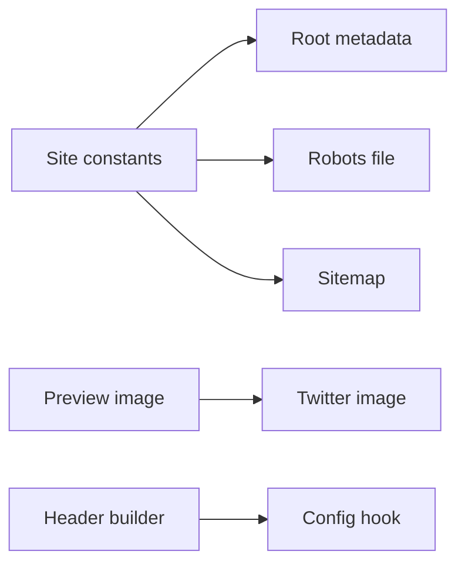
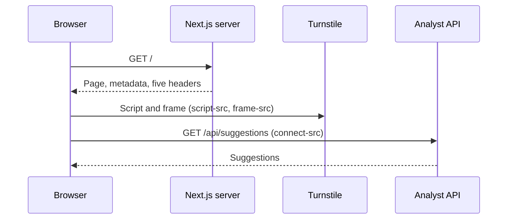

# 30 SEO + security headers

| | |
|---|---|
| Work | Feature: metadata, a preview card, robots and sitemap files, and security headers for the public web page |
| Change | `d40c5c6` on `main` (squash of `feature/seo-security-headers`), 2026-11-01 |
| Evidence | `blueprint/history/features/30-seo-security-headers.md` (spec and independent review receipt), the commit message, and the build conversation |
| Reader | A learner who can write basic code and is new to this stack |

This document obeys the rules of ASD-STE100 Simplified Technical
English. It is not a certified STE document.

## 1. Summary

This work prepares the web page of Highbury for the public launch on 2026-11-02. It gives search engines and link previews a title, a description, an image, and one canonical address. It also adds five HTTP headers that tell the browser what the page can load and who can show the page in a frame. The one idea to remember: the Content-Security-Policy (CSP) is a list of permitted origins. The API and Cloudflare Turnstile are the only external origins on it.

## 2. Why this work exists

Before this work, the page had a title and a description, but no canonical address and no preview image. A link to the site in a chat app showed a plain URL. Search engines also found the page at two addresses: the Vercel URL and `highbury.arkaslittlemind.com`.

The page also sent no security headers. Thus any other site could show Highbury inside a frame, and the browser could load a script from any origin. The plan made both problems part of the public launch (v1.3, item 30). Source: the spec.

## 3. Design

The design has two halves. Next.js file conventions make the SEO files, and one pure function makes the headers that `next.config.ts` sends.

| Part | Location | Job |
|---|---|---|
| Site constants | `apps/web/src/lib/site.ts` | Holds the canonical origin and the description in one place. |
| Root metadata | `apps/web/src/app/layout.tsx` | Writes the canonical link, the title template, and the Open Graph and Twitter tags. |
| Preview image | `apps/web/src/app/opengraph-image.tsx` | Draws a 1200 x 630 PNG card with text only. |
| Twitter image | `apps/web/src/app/twitter-image.tsx` | Gives the same card to the Twitter tags. |
| Robots file | `apps/web/src/app/robots.ts` | Lets all crawlers in and names the sitemap. |
| Sitemap | `apps/web/src/app/sitemap.ts` | Lists the one page of the site. |
| Header builder | `apps/web/src/lib/security-headers.ts` | Makes the CSP string and the four other headers. |
| Config hook | `apps/web/next.config.ts` | Sends the headers on every path. |

Open Graph is a set of `<meta>` tags that chat apps and social sites read to draw a link preview. This work uses it because a link to the launch must show a title and an image.

A canonical link is a `<link rel="canonical">` tag that names the one true address of a page. This work uses it because the same page answers at the Vercel URL and at the custom domain.

## 4. Workflow

Example input: a browser asks for `https://highbury.arkaslittlemind.com/`.

1. Next.js reads `headers()` in the config at build time. (`apps/web/next.config.ts:10`)
2. The hook calls `securityHeaders` with `NEXT_PUBLIC_API_URL` and the build mode. (`apps/web/next.config.ts:14`)
3. `securityHeaders` calls `buildCsp` for the policy string. (`apps/web/src/lib/security-headers.ts:44`)
4. `buildCsp` calls `apiOrigin`, which keeps only the scheme, host, and port of the URL. (`apps/web/src/lib/security-headers.ts:9`)
5. `buildCsp` puts that origin into `connect-src` and joins the directives. (`apps/web/src/lib/security-headers.ts:34`)
6. The server sends the prerendered page with the five headers and the metadata tags. (`apps/web/src/app/layout.tsx:27`)
7. The browser loads the Turnstile script, which `script-src` permits. (`apps/web/src/hooks/use-turnstile.ts:8`)
8. The page fetches suggestions from the API, which `connect-src` permits. (`apps/web/src/lib/ask-stream.ts:175`)

The headers come from the build, not from each request. The build reads the API URL one time, as the browser bundle does.

## 5. Decisions and tradeoffs

### 5.1 The CSP has no nonce

- **Choice:** `script-src` permits `'unsafe-inline'`. This is the "Without Nonces" form of the Next.js CSP guide.
- **Alternatives:** A nonce for each request, or the experimental hash form (SRI) of the guide.
- **Reason:** Recorded: the page uses `cacheComponents`, and the guide says a nonce needs a render for each request. It also says that Partial Prerendering does not work with a nonce. The SRI form is experimental. Source: the spec, Notes for the AI, and the code comment at `security-headers.ts:18`.
- **Cost:** An injected inline script can run. The other directives limit the damage: the script cannot send data to an origin that is not on `connect-src`.

### 5.2 The API origin comes from the build environment

- **Choice:** The config reads `NEXT_PUBLIC_API_URL` and keeps only its origin.
- **Alternatives:** A hard-coded API host in the policy, or a separate CSP variable.
- **Reason:** Recorded: the bundle already reads this value at build time, so one value controls both. `URL.origin` drops a path or a final slash that slips in. Source: the spec, Data / contracts.
- **Cost:** A new API origin needs a new web build. A wrong value on Vercel blocks every question on the live page.

### 5.3 The canonical origin is a constant

- **Choice:** `SITE_URL` in `site.ts` is a fixed string.
- **Alternatives:** An environment variable.
- **Reason:** Recorded: the plan fixes one canonical domain, so a variable adds a setting with no current need. Source: the spec, build step 3.
- **Cost:** A change of domain needs a code change.

### 5.4 The preview image is text only, from code

- **Choice:** `ImageResponse` from `next/og` draws the card with the built-in font and the colors of `globals.css`.
- **Alternatives:** A static PNG file, or a card with the brand fonts.
- **Reason:** Recorded: the project uses no crest, logo, or player photo. The spec also says not to fetch fonts at build time. Source: `AGENTS.md` and the spec, Notes for the AI.
- **Cost:** The card does not use Barlow Condensed, so it looks plainer than the page.

### 5.5 The robots file stays plain

- **Choice:** One rule that lets all user agents in.
- **Alternatives:** Rules for each AI crawler in this work.
- **Reason:** Recorded: item 30b owns the AI crawler rules, so this work leaves the file plain for 30b to extend. Source: the spec, Out of scope.
- **Cost:** Until item 30b lands, AI training crawlers can read the page.

### 5.6 Two headers deny framing

- **Choice:** `frame-ancestors 'none'` and `X-Frame-Options: DENY`.
- **Alternatives:** Only `frame-ancestors`.
- **Reason:** Recorded: old browsers do not read `frame-ancestors`. Source: the code comment at `security-headers.ts:49`.
- **Cost:** No site can embed Highbury, also not a friendly one.

## 6. Blast radius

### 6.1 This work needs

| Dependency | Used for | If it fails |
|---|---|---|
| `NEXT_PUBLIC_API_URL` on Vercel | The `connect-src` origin | If it is wrong, the browser blocks the API. The page shows no suggestions and cannot ask. |
| `challenges.cloudflare.com` | The Turnstile script and frame | If Cloudflare moves the script to a new host, the CSP blocks it and questions fail. |
| `next/font` | Fonts from `'self'` | If a font loads from Google, the CSP blocks it and text falls back to a system font. |
| Vercel domain settings | The redirect to the canonical domain | If the redirect is absent, the Vercel URL still answers. The canonical tag still names the custom domain. |

### 6.2 These things use this work

| Consumer | Uses | Found in |
|---|---|---|
| Next.js config | `securityHeaders` | `apps/web/next.config.ts:3` |
| Root layout | `SITE_URL`, `SITE_DESCRIPTION` | `apps/web/src/app/layout.tsx:3` |
| Robots file | `SITE_URL` | `apps/web/src/app/robots.ts:3` |
| Sitemap | `SITE_URL` | `apps/web/src/app/sitemap.ts:3` |
| Twitter image | The Open Graph image exports | `apps/web/src/app/twitter-image.tsx:2` |

### 6.3 If you change this work

| If you change | Then check |
|---|---|
| Add an external script, frame, image, or API host | Add its origin in `buildCsp`, or the browser blocks it. `AGENTS.md` records this rule. |
| `SITE_URL` | The canonical tag, `og:url`, the image URLs, the robots file, and the sitemap. |
| `robots.ts` | Item 30b extends this file with crawler rules. |
| Server-side `style` attributes in charts | `style-src` keeps `'unsafe-inline'` for them. |

### 6.4 How to remove this work

Revert `d40c5c6`. This removes the headers, the metadata, and the four route files. No data or database change stays behind. The Vercel redirect is a dashboard setting, so remove it there by hand.

## 7. Code reading path

1. [`apps/web/src/lib/site.ts:3`](../apps/web/src/lib/site.ts#L3) - Look for: the one canonical origin.
2. [`apps/web/src/app/layout.tsx:26`](../apps/web/src/app/layout.tsx#L26) - Look for: `metadataBase`, which turns relative URLs into absolute URLs.
3. [`apps/web/src/app/opengraph-image.tsx:17`](../apps/web/src/app/opengraph-image.tsx#L17) - Look for: a card built from JSX with inline styles.
4. [`apps/web/src/app/robots.ts:5`](../apps/web/src/app/robots.ts#L5) - Look for: a route that returns an object, not a file.
5. [`apps/web/src/lib/security-headers.ts:18`](../apps/web/src/lib/security-headers.ts#L18) - Look for: the comment that explains why the policy has no nonce.
6. [`apps/web/src/lib/security-headers.ts:23`](../apps/web/src/lib/security-headers.ts#L23) - Look for: each directive and its comment.
7. [`apps/web/src/lib/security-headers.test.ts:13`](../apps/web/src/lib/security-headers.test.ts#L13) - Look for: tests that read one directive at a time.
8. [`apps/web/next.config.ts:10`](../apps/web/next.config.ts#L10) - Look for: the `/:path*` source that covers every path.

## 8. Known limits

- The CSP permits inline scripts (see 5.1).
- The live checks wait for the push to `main`. These are the headers on the live domain, a link preview test, and the Vercel redirect.
- Preview deployments on Vercel load a toolbar script from `vercel.live`, which the CSP blocks. Previews are not part of the deploy path. Source: the spec.
- The independent review found no defects. It named one risk: the production CSP depends on the correct `NEXT_PUBLIC_API_URL` on Vercel.
- The project has no web typecheck script and no browser tests. `pnpm build` runs TypeScript.

## 9. Self-test

1. Why does `script-src` contain `'unsafe-inline'`?
2. What happens if `NEXT_PUBLIC_API_URL` on Vercel names an old API host?
3. Why does the page send `X-Frame-Options` when the CSP has `frame-ancestors`?
4. What happens if a later change loads a font from Google Fonts with a `<link>` tag?
5. Why is `SITE_URL` a constant and not an environment variable?

Answers

1. Next.js prerenders the page under `cacheComponents`, and a nonce needs a render for each request. See section 5.1.
2. The browser blocks each call to the real API. Thus the page shows no suggestions and cannot ask. See sections 5.2 and 6.1.
3. Old browsers do not read `frame-ancestors`. See section 5.6.
4. The CSP permits fonts and styles from `'self'` only, so the browser blocks the font. See sections 6.1 and 6.3.
5. The plan fixes one canonical domain, and a variable adds a setting with no current need. See section 5.3.

