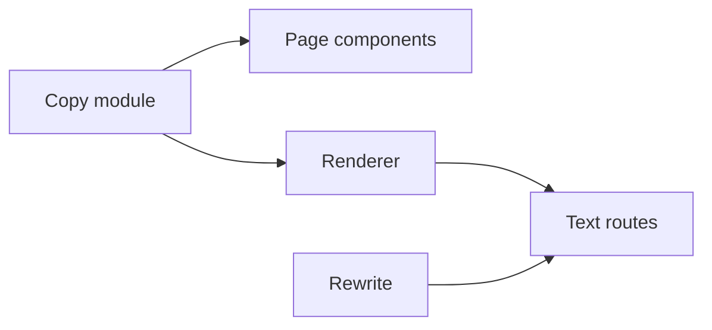
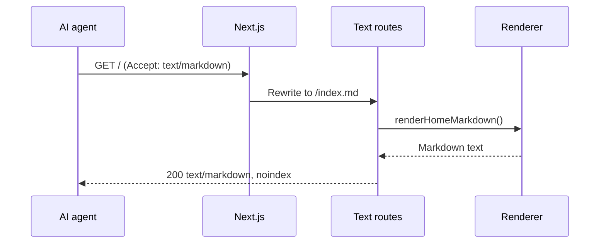

# 30b AI-readable site

| | |
|---|---|
| Work | Feature: a Markdown copy of the page, `llms.txt`, JSON-LD, and rules for AI crawlers |
| Change | `48b5f82` on `main` (squash of `feature/ai-readable-site`, three checkpoints), 2026-11-02 |
| Evidence | `blueprint/history/features/30b-ai-readable-site.md` (spec, findings 30b/F-01 and 30b/F-02, review receipt), the commit messages, the ScrollLaunch prompt, and the build conversation |
| Reader | A learner who can write basic code and is new to this stack |

This document obeys the rules of ASD-STE100 Simplified Technical
English. It is not a certified STE document.

## 1. Summary

This work gives AI agents a text copy of the Highbury page and tells AI crawlers what they can do. An agent can read `/index.md`, `/llms.txt`, or `/llms-full.txt`, or ask for `/` with `Accept: text/markdown`. The page head gets an `ai-summary` tag, a link to the Markdown, and JSON-LD. `robots.txt` lets search and AI search in, but blocks AI training crawlers. The one idea to remember: the page and the text copy read the same copy module, so their facts cannot drift apart.

## 2. Why this work exists

Before this work, an AI agent that read the site got a large HTML page with scripts, charts, and styles. The facts were in the page, but an agent had to dig them out. Also, `robots.txt` let every crawler in, with no difference between AI search and AI training.

The user asked to apply the ScrollLaunch prompt "AI-readable site" to the repository. The user then approved build-plan item 30b and chose to block the training crawlers. Source: the build conversation and the spec.

## 3. Design

The design has one copy module, one renderer, three routes, and two changes to the page head and the crawler rules.

| Part | Location | Job |
|---|---|---|
| Copy module | `apps/web/src/lib/landing-content.ts` | Holds the text of the landing page as plain data. |
| Page components | `apps/web/src/components/ask/hero.tsx`, `how-it-works.tsx`, `seasons.tsx`, `apps/web/src/app/page.tsx` | Render the copy module as HTML, with the same output as before. |
| Renderer | `apps/web/src/lib/ai-readable.ts` | Turns the copy module into the Markdown page and the two text files. |
| Text routes | `apps/web/src/app/index.md/route.ts`, `llms.txt/route.ts`, `llms-full.txt/route.ts` | Serve the renderer output with the correct headers. |
| Rewrite | `apps/web/next.config.ts` | Sends `/` to `/index.md` when a client asks for Markdown. |
| Head tags | `apps/web/src/app/layout.tsx` | Add `ai-summary`, the Markdown link, and the JSON-LD script. |
| Crawler rules | `apps/web/src/app/robots.ts` | Sort crawlers into three groups. |

`llms.txt` is a plain-text file at the site root that gives AI agents a short guide to a site, with links. This work uses it because agents look for that file first.

JSON-LD is a block of JSON in a `<script type="application/ld+json">` tag that tells machines what a page is about. This work uses it to describe Highbury as an `Organization` and a `WebSite`.

## 4. Workflow

Example input: an AI agent sends `GET /` with `Accept: text/markdown`.

1. Next.js applies the config headers for `/`, then checks the `beforeFiles` rewrites. (`apps/web/next.config.ts:30`)
2. The `has` rule finds `text/markdown` in the `accept` header. (`apps/web/next.config.ts:33`)
3. Next.js serves `/index.md` in place of the page. (`apps/web/src/app/index.md/route.ts:6`)
4. The handler calls `renderHomeMarkdown`. (`apps/web/src/lib/ai-readable.ts:22`)
5. The renderer reads `HERO`, `HOW_IT_WORKS`, and `SEASONS` from the copy module. (`apps/web/src/lib/landing-content.ts:6`)
6. The handler sends the text as `text/markdown` with `noindex` and a canonical link. (`apps/web/src/app/index.md/route.ts:12`)

A browser sends `text/html` and `*/*`, so step 2 finds no match, and the browser gets the HTML page.

The build runs the three routes one time. Thus each request gets a stored file, and no code runs per request.

## 5. Decisions and tradeoffs

### 5.1 One copy module for the page and the text

- **Choice:** The landing text moved from three components into `landing-content.ts`, and the page and the renderer both read it.
- **Alternatives:** A separate hand-written Markdown file, or text taken from the rendered HTML.
- **Reason:** Recorded: one module makes sure that the facts cannot drift apart. The ScrollLaunch prompt also says to render from data, not from the HTML. Source: the spec, step 1, and the prompt.
- **Cost:** The components now read their headlines from data. A build step compared the page text before and after to prove that nothing changed.

### 5.2 Only the page's own facts

- **Choice:** The text copy says only what the page says. The summaries are `SITE_DESCRIPTION` itself, and tests pin them.
- **Alternatives:** Extra sentences that are true but not on the page.
- **Reason:** Recorded: the first review found three such claims (30b/F-01). The first repair then pasted a hand copy of the hero sentence (30b/F-02). The second repair removed the hand copy. Source: the archived findings.
- **Cost:** The summary in `llms.txt` is short. It cannot add a fact that the page does not show.

### 5.3 A rewrite in `beforeFiles`

- **Choice:** A `beforeFiles` rewrite with a `has` rule on the `accept` header.
- **Alternatives:** An `afterFiles` rewrite, or a `proxy` file that runs on each request.
- **Reason:** Recorded: an `afterFiles` rewrite runs only when no page matches, and `/` is a page. Source: the spec and the code comment at `next.config.ts:28`.
- **Cost:** The rule does not read q-values. A client that names `text/markdown` at any weight gets Markdown.

### 5.4 No `Vary: Accept` on the HTML

- **Choice:** Keep the config value, which reaches only the Markdown answer. Next.js puts its own `Vary` on the HTML page.
- **Alternatives:** A `proxy` file that sets `Vary` on every answer for `/`.
- **Reason:** Recorded: the user chose option A. Vercel runs the rewrite before its cache, and Cloudflare does not cache HTML by default. Source: the spec, step 3 revision.
- **Cost:** A cache that ignores the rewrite could mix the two answers. The live check after the push tests this.

### 5.5 Block AI training, allow AI search

- **Choice:** Allow six AI search and user-fetch agents, block four training agents, and allow all other crawlers.
- **Alternatives:** Allow all crawlers, or block all AI crawlers.
- **Reason:** Recorded: the user chose to block training. The block does not stop search agents, which can still cite the site. Source: the build conversation and the comment at `robots.ts:18`.
- **Cost:** A future model does not learn about Highbury from its training data. `Applebot-Extended` and `Bytespider` stay allowed, because the plan named four agents and the user did not add them.

### 5.6 The ScrollLaunch prompt, cut to one page

- **Choice:** No `/ai.txt`, no `/api/md` routes, no route registry, and no token or CORS headers.
- **Alternatives:** The full prompt.
- **Reason:** Recorded: the site has one public page, so a registry and a catalog add parts with no current use. The plan line excluded `/ai.txt`. Source: the spec, Out of scope.
- **Cost:** A second page needs its own route and a new link in `llms.txt`.

## 6. Blast radius

### 6.1 This work needs

| Dependency | Used for | If it fails |
|---|---|---|
| `SITE_URL`, `SITE_DESCRIPTION` | Absolute links and the summaries | A wrong value gives wrong links in every text file and in the JSON-LD. |
| The Next.js rewrite order | Markdown on `/` | If `beforeFiles` changes, agents that ask for Markdown get HTML. Browsers are not affected. |
| Vercel and Cloudflare caches | Keep HTML and Markdown apart | If a cache mixes them, a browser can get Markdown on `/`. |
| Cloudflare cache for `.txt` | Speed | After a deploy, `/llms.txt` can show old text for up to a day. |

### 6.2 These things use this work

| Consumer | Uses | Found in |
|---|---|---|
| Hero | `HERO` | `apps/web/src/components/ask/hero.tsx:216` |
| How it works | `HOW_IT_WORKS` | `apps/web/src/components/ask/how-it-works.tsx:22` |
| Seasons | `SEASONS` | `apps/web/src/components/ask/seasons.tsx:77` |
| Page footer | `NOTICE`, `DATA_SOURCES` | `apps/web/src/app/page.tsx:33` |
| Text routes | The three render functions | `apps/web/src/app/index.md/route.ts:6` |

### 6.3 If you change this work

| If you change | Then check |
|---|---|
| The landing text | Change it in `landing-content.ts`. The page and the text files then change together. |
| `SITE_DESCRIPTION` | The `ai-summary` tag, the JSON-LD, and both summaries change. The tests still pass, because they read the same value. |
| Add a public page | Add a route for its Markdown and a link in `renderLlmsTxt`. |
| The crawler lists in `robots.ts` | Change the lists in `robots.test.ts` too. |

### 6.4 How to remove this work

Revert `48b5f82`. This removes the three routes, the rewrite, the head tags, and the crawler groups, and moves the copy back into the components. No data stays behind. Cached copies of `/llms.txt` on Cloudflare expire in one day.

## 7. Code reading path

1. [`apps/web/src/lib/landing-content.ts:6`](../apps/web/src/lib/landing-content.ts#L6) - Look for: the copy as plain data with no JSX.
2. [`apps/web/src/components/ask/how-it-works.tsx:22`](../apps/web/src/components/ask/how-it-works.tsx#L22) - Look for: one text node, so the server HTML gets no extra comment.
3. [`apps/web/src/lib/ai-readable.ts:22`](../apps/web/src/lib/ai-readable.ts#L22) - Look for: how each Markdown section comes from the copy module.
4. [`apps/web/src/lib/ai-readable.test.ts:15`](../apps/web/src/lib/ai-readable.test.ts#L15) - Look for: the tests that pin the summary and the links.
5. [`apps/web/src/app/index.md/route.ts:6`](../apps/web/src/app/index.md/route.ts#L6) - Look for: the headers, and why the copy is `noindex`.
6. [`apps/web/next.config.ts:28`](../apps/web/next.config.ts#L28) - Look for: why the rewrite is in `beforeFiles`.
7. [`apps/web/src/app/layout.tsx:55`](../apps/web/src/app/layout.tsx#L55) - Look for: the JSON-LD graph and the escape of `<` at line 98.
8. [`apps/web/src/app/robots.ts:7`](../apps/web/src/app/robots.ts#L7) - Look for: the three crawler groups and their comments.

## 8. Known limits

- The HTML of `/` has no `Vary: Accept` (see 5.4). The live check after the push tests the caches.
- The `accept` match ignores q-values and is case-sensitive.
- Other `.md` paths get the normal Next.js 404 page, not a Markdown 404.
- `Applebot-Extended` and `Bytespider` are not blocked.
- The third review closed the two findings, 30b/F-01 and 30b/F-02. The ledger has no open finding.

## 9. Self-test

1. Why does the rewrite use `beforeFiles` and not `afterFiles`?
2. What happens if you change the hero text in `hero.tsx` only?
3. Why does `/index.md` send `X-Robots-Tag: noindex`?
4. What happens to citations in AI search when `robots.txt` blocks the training crawlers?
5. What happens if a cache in front of the site ignores the rewrite and stores one answer for `/`?

Answers

1. An `afterFiles` rewrite runs only when no page matches, and `/` is a page. See section 5.3.
2. The hero text is no longer in `hero.tsx`. It is in the copy module, which the page and the text files share. See sections 5.1 and 6.3.
3. The HTML page is the one for search results, and the Markdown is a copy of it. See section 4.
4. Nothing changes. The search agents are in a different group and stay allowed. See section 5.5.
5. A browser can get the Markdown, or an agent can get the HTML. See sections 5.4 and 6.1.

