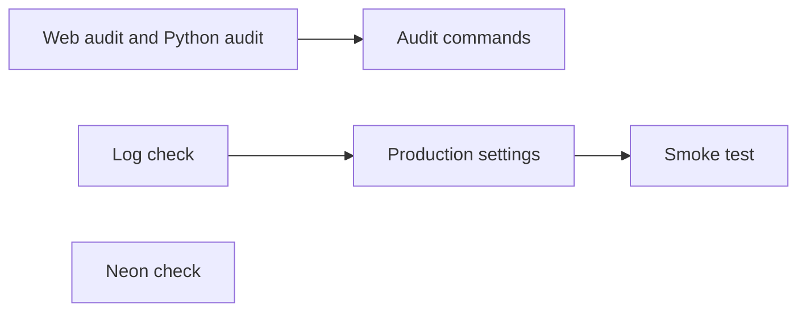
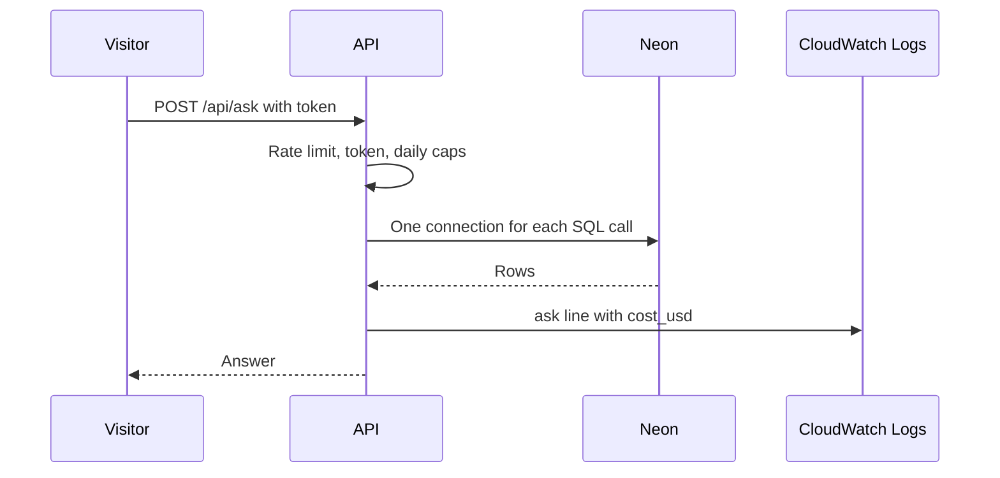

# 31 Pre-launch checklist

| | |
|---|---|
| Work | Feature: five launch checks with evidence, dependency fixes, two production setting changes, and the user's launch sign-off |
| Change | `f2d5372` on `main` (squash of `feature/pre-launch-checklist`), 2026-11-02 |
| Evidence | `blueprint/history/features/31-pre-launch-checklist.md` (spec with the Evidence, Decisions, and Sign-off sections, two review receipts), the commit message, and the build conversation |
| Reader | A learner who can write basic code and is new to this stack |

This document obeys the rules of ASD-STE100 Simplified Technical
English. It is not a certified STE document.

## 1. Summary

This item proves that Highbury is ready for the public launch on 2026-11-02. It ran five checks: dependency audits, the Gemini spend, the Neon limits, a day of API logs, and a live smoke test. The checks found two gaps, and the user closed both. The logs had no cost, and the Gemini balance was too small for the site cap. The one idea to remember: most of this item is evidence, not code, and the evidence lives in the archived spec.

## 2. Why this work exists

Highbury opens to the general public on 2026-11-02. Earlier work added daily caps, a bot check, and security headers. Before launch, the user wanted proof that the parts outside the code are also ready. These parts are the libraries, the database plan, the model credits, and the live site. Source: build-plan item 31 and the launch notes.

A dependency audit compares the versions in a lockfile with a database of known security problems (advisories). This work uses `pnpm audit` for the web app and `pip-audit` for the Python side.

## 3. Design

The item has one part for each check. Only the first two parts change tracked files.

| Part | Location | Job |
|---|---|---|
| Web audit | `apps/web/package.json`, `pnpm-lock.yaml`, `pnpm-workspace.yaml` | Removes the high advisories from the web dependencies. |
| Python audit | `uv.lock` | Removes the advisories from the Python dependencies. |
| Audit commands | `AGENTS.md` | Records the two audit commands for the next run. |
| Neon check | The database and the Neon docs | Compares the database limits with the API. |
| Log check | CloudWatch Logs | Measures questions, tokens, cost, and latency for one day. |
| Production settings | `deploy/ecs/service.json` (ignored) and ECS | Adds the prices and lowers the site cap. |
| Smoke test | The live site and a local copy | Proves each path a visitor can take. |

## 4. Workflow

Example input: one visitor question on the live site after this item.

1. The page gets a Turnstile token and sends `POST /api/ask`.
2. The API checks the rate limit, the token, then the daily caps (10 an address, 100 for the site).
3. The agent opens one database connection for each SQL call. At most 10 turns run at once. (`services/analyst/src/analyst/api.py:75`)
4. A connection waits at most 10 s. A suspended Neon compute wakes in a few hundred milliseconds. (`services/analyst/src/analyst/db.py:12`)
5. At the end, the API writes one `ask` log line with tokens and, now, `cost_usd`. (`services/analyst/src/analyst/api.py:497`)

The smoke test followed this path live. The new question cost $0.045 and the refusal $0.022, and both log lines carried the cost.

## 5. Decisions and tradeoffs

### 5.1 Fix every high advisory, also in tools that do not ship

- **Choice:** Update `shadcn` to 4.23.0 and add an override for `systeminformation`.
- **Alternatives:** Write a reason for each high advisory and change nothing, because all seven came from the `shadcn` CLI, which does not ship.
- **Reason:** Recorded: a minor update and one patch override cleared all seven at a low risk, and a clean audit is easier to repeat. Source: the spec Evidence and the comment at `apps/web/pnpm-workspace.yaml:6`.
- **Cost:** The override must go when `@dotenvx/dotenvx` requires the fix. The independent review raised F-01: Vercel must install with pnpm 10 for the override to work.

### 5.2 `pip-audit` through `uvx`

- **Choice:** Run `uvx pip-audit` on a requirements file from `uv export`.
- **Alternatives:** Add `pip-audit` as a dev dependency.
- **Reason:** Recorded: `uvx` runs the tool in a throwaway environment, so the project gets no new dependency. Source: the spec, step 2, and `AGENTS.md:84`.
- **Cost:** Each run downloads the tool again.

### 5.3 Prices on the ECS service

- **Choice:** Add `ANALYST_INPUT_USD_PER_MTOK` and `ANALYST_OUTPUT_USD_PER_MTOK` to the production service.
- **Alternatives:** Compute the cost from tokens by hand for each check.
- **Reason:** Recorded: the user approved it after the log check found `cost_usd` was `null` in all 66 lines of the week. Source: the spec Decisions.
- **Cost:** The prices are a copy of the provider's prices. If the provider changes them, the log values are wrong until someone updates the service.

### 5.4 A site cap of 100 until the top-up

- **Choice:** Lower `DAILY_LIMIT_TOTAL` from 250 to 100.
- **Alternatives:** Top up the Gemini credits before the launch.
- **Reason:** Recorded: the balance of Rs 409.34 covers about 110 questions, but the cap allowed 250. An empty balance stops every answer for every visitor. Source: the spec Evidence and the user's decision.
- **Cost:** A busy day stops at 100 questions. The user must raise the cap after the top-up.

### 5.5 The daily cap tested locally

- **Choice:** Run the API with a cap of 1 and a local web build, then ask 2 questions.
- **Alternatives:** Ask 10 questions on the live site.
- **Reason:** Recorded: the local test costs 1 question, and a read-only check confirmed the production caps. Source: the spec Decisions.
- **Cost:** The live cap message was not seen. The same code and text run in production.

## 6. Blast radius

### 6.1 This work needs

| Dependency | Used for | If it fails |
|---|---|---|
| Vercel with pnpm 10 | The `systeminformation` override | The web build can fail. A failed build does not replace the live site (F-01). |
| Gemini prepaid credits | Every answer | An empty balance gives the credits-out message to every visitor. |
| Neon Free, 0.25 CU | The data | The compute suspends after 5 minutes. A wake-up adds a few hundred milliseconds. |
| Cloud billing budget | Spend warnings | The user set it up. A budget warns about spend, not about the balance. |

### 6.2 These things use this work

| Consumer | Uses | Found in |
|---|---|---|
| The `ask` log line | The two price settings | `services/analyst/src/analyst/settings.py:32` |
| The next dependency audit | The two commands | `AGENTS.md:84` and `AGENTS.md:97` |
| The web install | The override | `apps/web/pnpm-workspace.yaml:5` |

### 6.3 If you change this work

| If you change | Then check |
|---|---|
| Top up the Gemini credits | Raise `DAILY_LIMIT_TOTAL` back to 250 with the same ECS update. |
| The model or its prices | Change both price settings on the service and in `.env.example`. |
| Update `@dotenvx/dotenvx` or `shadcn` | Remove the override if the new version needs `systeminformation` 5.33.16 or later. |

### 6.4 How to remove this work

Revert `f2d5372` to undo the dependency changes and the two commands. The two ECS changes are not in Git. To undo them, edit `deploy/ecs/service.json` and send the same ECS update.

## 7. Code reading path

1. [`apps/web/pnpm-workspace.yaml:5`](../apps/web/pnpm-workspace.yaml#L5) - Look for: the override and the reason in its comment.
2. [`apps/web/package.json:21`](../apps/web/package.json#L21) - Look for: the `shadcn` range after the update.
3. [`AGENTS.md:84`](../AGENTS.md#L84) - Look for: the Python audit command and why it uses `uvx`.
4. [`services/analyst/src/analyst/api.py:497`](../services/analyst/src/analyst/api.py#L497) - Look for: how `cost_usd` comes from the two prices.
5. [`services/analyst/src/analyst/db.py:12`](../services/analyst/src/analyst/db.py#L12) - Look for: the connect timeout that the Neon check compared.

## 8. Known limits

- Nobody has confirmed F-01 (P3) yet. The Vercel build log after the push must show a pnpm 10 install.
- The dependency fixes are not live until the web push and a new API image.
- The site cap is 100 until the top-up.
- Five moderate and three low web advisories remain, all in dev tools.
- The limit card offers "Ask again" when the daily cap stops a visitor. That button cannot help until the next day. A later `/fix` can change it.

## 9. Self-test

1. Why did the site cap go down from 250 to 100?
2. What happens to the log line if the model prices change and nobody updates the service?
3. Why does the Python audit use `uvx` and not a dev dependency?
4. What happens if Vercel installs with pnpm 9 after this change?
5. Why did the daily-cap test run locally and not on the live site?

Answers

1. The Gemini balance covered about 110 questions, and an empty balance stops every answer. See section 5.4.
2. `cost_usd` shows a wrong value, because the service keeps the old prices. See section 5.3.
3. The project gets no new dependency. See section 5.2.
4. The build can fail, but a failed build does not replace the live site. See sections 5.1 and 6.1.
5. The local test costs 1 question, and a read-only check confirmed the production caps. See section 5.5.

