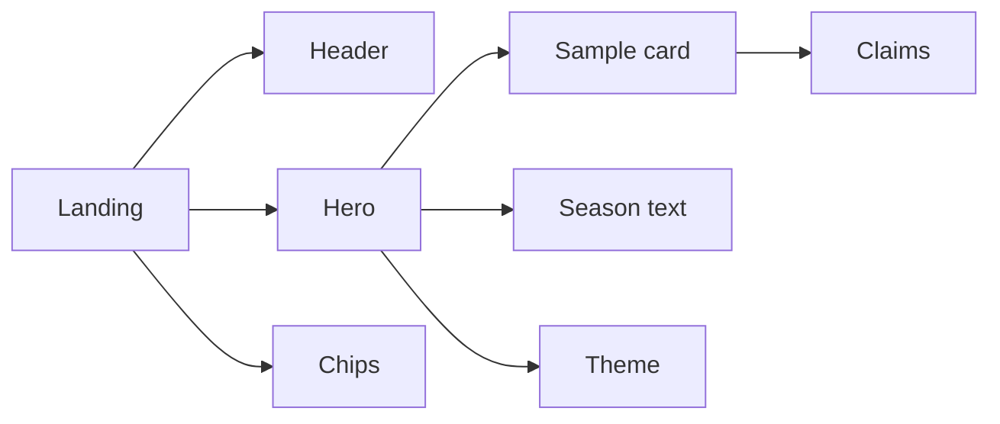
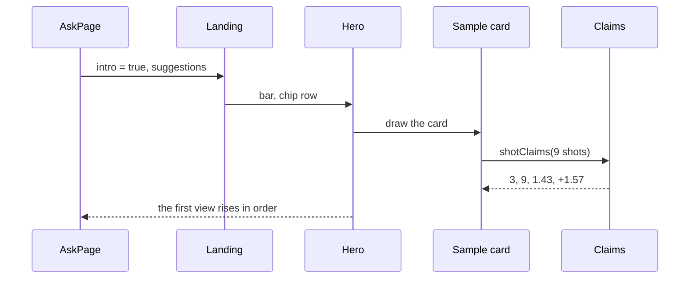

# 32a Hero + header

| | |
|---|---|
| Work | Feature: the first screen of the landing redesign, with a centred hero, a logo in the header, and a checked answer card below the fold |
| Change | `0eaeaf4` on `main` (squash of `feature/hero-header`), 2026-11-07 |
| Evidence | `blueprint/history/features/32a-hero-header.md` (spec and build notes, no findings, no independent review), the commit message, and the build conversation |
| Reader | A learner who can write basic code and is new to this stack |

This document obeys the rules of ASD-STE100 Simplified Technical
English. It is not a certified STE document.

## 1. Summary

This item is the first of five sections of the landing redesign (item 32). It replaces the top of the landing screen with variant A of the local hero prototype. The hero shows a centred headline, a short sub line, the question bar, and the example chips. Below them, a sample answer card shows the top part of a checked answer, and the bottom of the hero cuts it. The one idea to remember: the card computes its numbers from the sample data. Thus it cannot show a number that its chart does not hold.

## 2. Why this work exists

Before this work, the hero had two columns. The text was on the left, and a small card with four promises was on the right. A separate "Try asking" row under the hero held the chips. Source: the spec, In scope.

The v1.4 plan asks for the design of `prototypes/hero/` with the same palette and fonts. The motion obeys Emil Kowalski's rules, and the page has no sideways scroll at 390 px. Source: `blueprint/build-plan.md`, v1.4.

The plan splits the redesign into five items, so each push to `main` stays small. This item does the hero and the header only. The sections below the hero do not change.

## 3. Design

The landing screen gives the hero three things: a flag for the first view, the question bar, and the chips. The hero draws the grass, the text, and the sample card. Two small functions in `lib/` give the card its numbers and the sub line its season text.

| Part | Location | Job |
|---|---|---|
| Header | `apps/web/src/components/ask/site-header.tsx` | Shows the logo, the name, the section links, and one button. |
| Landing | `apps/web/src/components/ask/landing.tsx` | Puts the bar and the chips into the hero, and keeps the chip row when the chips load. |
| Hero | `apps/web/src/components/ask/hero.tsx` | Draws the grass, the centred text, and the cut sample card, with the first-view motion. |
| Sample card | `apps/web/src/components/ask/hero.tsx` (`SampleCard`) | Draws the shot map and the four claims of the sample answer. |
| Claims | `apps/web/src/lib/shot-map.ts` (`shotClaims`) | Computes goals, shots, total xG, and goals minus xG from a list of shots. |
| Season text | `apps/web/src/lib/utils.ts` (`keepSeasonsWhole`) | Puts a non-breaking hyphen into each season, such as 2003-04. |
| Theme | `apps/web/src/app/globals.css` | Holds the gutter token, the grass, the stripes, and the shade. |
| Chips | `apps/web/src/components/ask/suggestion-chips.tsx` | Takes two new class props, so the hero can give the chips a glass look. |

A non-breaking hyphen (U+2011) looks like a hyphen, but a browser does not break a line at it. The sub line uses it so that "2003-04" never splits over two lines.

## 4. Workflow

Example input: a visitor opens `/` for the first time, and the API sends four suggestions.

1. `AskPage` shows `Landing` with `intro={!asked}`, which is true on the first view. ([ask-page.tsx:67](../apps/web/src/components/ask/ask-page.tsx#L67))
2. `Landing` shows the header and gives a focus function to its button. ([landing.tsx:41](../apps/web/src/components/ask/landing.tsx#L41))
3. `Landing` gives the hero the bar and a chip row. While the suggestions load, the row is empty but keeps its height. ([landing.tsx:56](../apps/web/src/components/ask/landing.tsx#L56))
4. `Hero` sets `data-intro` on the section, so the motion classes start. ([hero.tsx:154](../apps/web/src/components/ask/hero.tsx#L154))
5. `Hero` writes the sub line through `keepSeasonsWhole`. ([hero.tsx:176](../apps/web/src/components/ask/hero.tsx#L176))
6. `SampleCard` calls `shotClaims` with the nine sample shots and gets 3, 9, 1.43, and +1.57. ([hero.tsx:64](../apps/web/src/components/ask/hero.tsx#L64), [shot-map.ts:172](../apps/web/src/lib/shot-map.ts#L172))
7. The parts rise in order, 60 ms apart. Then the card lifts 40 px over 900 ms. ([hero.tsx:24](../apps/web/src/components/ask/hero.tsx#L24))

## 5. Decisions and tradeoffs

### 5.1 The card computes its numbers

- **Choice:** `shotClaims` computes the four claims from `SAMPLE_SHOT_MAP`, and a test checks 3, 9, 1.43, and +1.57.
- **Alternatives:** Type the four numbers into the markup, as the prototype does.
- **Reason:** Recorded: a card that says "Checked answer" must not show a number that nobody checked. Source: the spec, In scope ("not from typed text"), and the critique in the build conversation.
- **Cost:** One more function and test. The difference uses a true minus sign (U+2212), so a search for "-0.40" does not find it.

### 5.2 Keep the existing motion classes

- **Choice:** The hero keeps the enter classes of `tw-animate-css`. It sets the prototype timings: a 12 px rise in 640 ms and a 40 px lift in 900 ms.
- **Alternatives:** Add new `rise` and `lift` keyframes, as the spec first said.
- **Reason:** Recorded: `globals.css` already has one reduced-motion rule. That rule sets the enter transform of these classes to zero, so each part only fades. Source: the build notes in the archive.
- **Cost:** The lift needs an exact value. `slide-in-from-bottom-10` means 10% of the height, not 40 px. A browser check found this, and the code now uses `slide-in-from-bottom-[40px]`.

### 5.3 Import the icon as an image

- **Choice:** The header imports `app/icon.svg` and shows it with `next/image`.
- **Alternatives:** Use the URL `/icon.svg`, or copy the SVG into the header.
- **Reason:** Recorded: the App Router serves the app icon at `/icon?<hash>`, not at `/icon.svg`. Thus a fixed URL fails. Source: the build notes, and the Next.js app-icons document.
- **Cost:** The build copies the file to `/_next/static/media/`, so the header and the favicon are two copies of one file.

### 5.4 A shorter sub line

- **Choice:** `HERO.intro` is now the sub line of the prototype.
- **Alternatives:** Keep the long text, which wraps over about six lines at 46 characters.
- **Reason:** Recorded: the spec chose the prototype text and named the cost. The user did not ask for a change at review. Source: the spec, Notes for the AI.
- **Cost:** `/index.md` and `/llms.txt` no longer say "When the data cannot answer, it says so."

### 5.5 The chips scroll in their own row on a phone

- **Choice:** Below 600 px, the chips stay on one row. The row scrolls sideways in its own box and runs to the edge of the screen.
- **Alternatives:** Let the chips wrap, which pushes the card far down.
- **Reason:** Recorded: the prototype does this, and the spec approved it. The page itself must not scroll sideways. Source: the spec, In scope.
- **Cost:** A visitor must find the cut chip to know that more chips exist.

## 6. Blast radius

### 6.1 This work needs

| Dependency | Used for | If it fails |
|---|---|---|
| `GET /api/suggestions` | The chips | The chip row goes away. The bar and the card stay. |
| `SAMPLE_SHOT_MAP` | The card chart and claims | A change to the data changes the card and fails the `shotClaims` test. |
| `tw-animate-css` and the reduced-motion rule | The first-view motion | Without the rule, reduced motion gets movement again. |

### 6.2 These things use this work

| Consumer | Uses | Found in |
|---|---|---|
| `Landing` | `Hero`, the chip classes | [landing.tsx:43](../apps/web/src/components/ask/landing.tsx#L43) |
| The answer screen | `SiteHeader` with the new logo | [ask-page.tsx:80](../apps/web/src/components/ask/ask-page.tsx#L80) |
| The page with no API URL | `SiteHeader` | [page.tsx:17](../apps/web/src/app/page.tsx#L17) |
| The Markdown copies | `HERO.intro` | [ai-readable.ts:32](../apps/web/src/lib/ai-readable.ts#L32) |
| `AnswerBody` | `SuggestionChips` with no new props | [answer-body.tsx:54](../apps/web/src/components/ask/answer-body.tsx#L54) |
| `ClosingAsk`, `Seasons` | The `mown` utility, at its old angle | `closing-ask.tsx`, `seasons.tsx` |

### 6.3 If you change this work

| If you change | Then check |
|---|---|
| `HERO.intro` | The page and `/index.md` both change. |
| The `mown` utility | `ClosingAsk` and `Seasons` use it too. |
| The `pill` style | The header button, the bar button, and the sample section use it. |
| The hero height or padding | At 1440 x 900, the card must still show above the fold. |

### 6.4 How to remove this work

Revert `0eaeaf4`. No data, environment variable, or API change stays behind. The revert brings back the two-column hero and the "Try asking" row.

## 7. Code reading path

1. [`landing.tsx:43`](../apps/web/src/components/ask/landing.tsx#L43) - Look for: how the landing gives the bar and the chips to the hero.
2. [`hero.tsx:150`](../apps/web/src/components/ask/hero.tsx#L150) - Look for: the centred stack and the fade at the bottom.
3. [`hero.tsx:24`](../apps/web/src/components/ask/hero.tsx#L24) - Look for: the motion classes that start only under `data-intro`.
4. [`globals.css:307`](../apps/web/src/app/globals.css#L307) - Look for: the rule that turns each enter motion into a fade.
5. [`hero.tsx:62`](../apps/web/src/components/ask/hero.tsx#L62) - Look for: the card, which uses the same `Pitch` and `ShotMark` as a real answer.
6. [`shot-map.ts:172`](../apps/web/src/lib/shot-map.ts#L172) - Look for: the round before the sign, so -0.001 does not show as -0.00.
7. [`site-header.tsx:42`](../apps/web/src/components/ask/site-header.tsx#L42) - Look for: the static image import of the icon.

## 8. Known limits

- At 390 px, the headline uses three lines at its smallest size of 36 px.
- The four API suggestions are long, so the chips use two rows on a wide screen. The prototype had one row.
- Nobody checked the return to the landing screen after an answer in a browser, because each question costs money. That path did not change.
- The Try links that fill the bar come in item 32b.

## 9. Self-test

1. Why does the card not type its numbers into the markup?
2. What happens if a visitor asks for reduced motion?
3. What happens if `/api/suggestions` fails?
4. Why does the header not use the URL `/icon.svg`?
5. What happens to `/llms.txt` if you change `HERO.intro`?

Answers

1. A typed number can disagree with the chart, but the card says that its numbers passed a check. Thus `shotClaims` computes them from the data. See section 5.1.
2. The global rule sets the enter transform to zero, so each part only fades. See sections 5.2 and 7.
3. The chip row goes away, and the bar and the card stay. See section 6.1.
4. The App Router serves the icon at `/icon?<hash>`, so a fixed URL fails. See section 5.3.
5. The Markdown copy changes too, because `ai-readable.ts` reads the same field. See sections 5.4 and 6.2.

