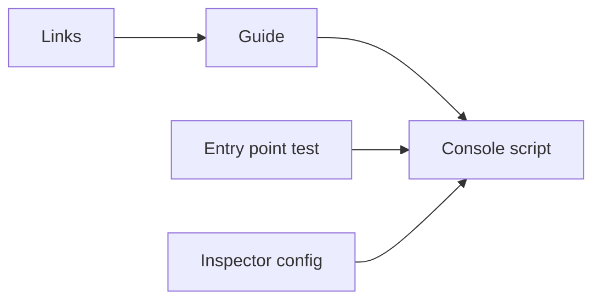
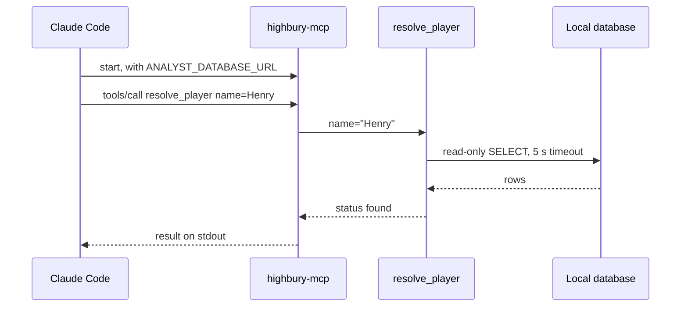

# 33 Published MCP server package and docs

| | |
|---|---|
| Work | Feature: a `highbury-mcp` command and one docs page, so that another developer can run the five data tools against a local database |
| Change | `93e8524` on `main` (squash of `feature/published-mcp-server-package-and-docs`), 2026-11-10 |
| Evidence | `blueprint/history/features/33-published-mcp-server-package-and-docs.md` (spec, findings 33/F-01 and 33/F-02, no independent review), build-plan item 33, the commit message, and the build conversation |
| Reader | A learner who can write basic code and is new to this stack |

This document obeys the rules of ASD-STE100 Simplified Technical
English. It is not a certified STE document.

## 1. Summary

This item gives other developers the five data tools of Highbury through their own MCP client. It adds one command, `highbury-mcp`, and one guide, `docs/mcp.md`. The guide tells a developer how to build a local database from the repository, install the command, and connect a client. Highbury hosts nothing new, and no raw data goes into the package. The one idea to remember: the developer brings the database and the model, and Highbury gives only the code.

## 2. Why this work exists

Feature 6 made an MCP server for the five tools, but only a person in this repository could start it. The start command was `python -m analyst.mcp_server` inside the uv workspace. No guide told an outside developer how to get the data or how to connect a client. Source: build-plan item 33.

The Model Context Protocol (MCP) is a standard way for an AI client to find and call tools. This work uses it because many clients already speak it, for example Claude Desktop, Claude Code, Cursor, and VS Code.

A second reason is cost. A question on the Highbury site costs Highbury money for the model. With this work, a developer asks through their own client, so the model cost is theirs. Source: build-plan, the note before item 33.

## 3. Design

The design adds a name for a function that already exists, then writes the path that leads to it. The server code itself does not change.

| Part | Location | Job |
|---|---|---|
| Console script | `services/analyst/pyproject.toml` | Gives `analyst.mcp_server:main` the command name `highbury-mcp`. |
| Entry point test | `services/analyst/tests/test_mcp_server.py` | Fails if the command name stops at a different function. |
| Inspector config | `services/analyst/mcp.json` | Starts the server with the new command inside the repository. |
| Guide | `docs/mcp.md` | Leads an outside developer from a clone to a connected client. |
| Links | `README.md`, `AGENTS.md` | Point readers and agents at the guide and the command. |

A console script is a command that a Python package declares. When a tool such as uv installs the package, it writes a small program with that name on the `PATH`. This work uses it because a client config needs one plain command, not a Python module path.

## 4. Workflow

Example input: Claude Code starts the server and calls `resolve_player` with the name "Henry".

1. Claude Code starts `highbury-mcp` with `ANALYST_DATABASE_URL` in its environment. ([docs/mcp.md:132](../docs/mcp.md#L132))
2. The console script imports `analyst.mcp_server` and calls `main`. ([pyproject.toml:25](../services/analyst/pyproject.toml#L25))
3. The import adds the five tool functions to the server. ([mcp_server.py:14](../services/analyst/src/analyst/mcp_server.py#L14))
4. `main` calls `get_settings`, which needs only the database URL. ([mcp_server.py:27](../services/analyst/src/analyst/mcp_server.py#L27))
5. If the environment has no URL, `main` stops and writes the variable name on stderr. ([mcp_server.py:32](../services/analyst/src/analyst/mcp_server.py#L32))
6. `server.run` reads protocol messages on stdin and writes replies on stdout. ([mcp_server.py:33](../services/analyst/src/analyst/mcp_server.py#L33))
7. The MCP layer checks that `name` is present, then calls `resolve_player`. ([tools.py:268](../services/analyst/src/analyst/tools.py#L268))
8. `resolve_player` reads the players and the nicknames through `db.read`. ([tools.py:278](../services/analyst/src/analyst/tools.py#L278))
9. `db.read` opens a read-only connection with a statement timeout. ([db.py:58](../services/analyst/src/analyst/db.py#L58))
10. The tool returns `found` with the exact `player` value. The client shows it to its model.

## 5. Decisions and tradeoffs

### 5.1 The command lives in the existing `analyst` package

- **Choice:** Add `highbury-mcp` to the `[project.scripts]` table of `analyst`, next to `ask` and `evals`.
- **Alternatives:** A separate thin package that holds only the server and the tools.
- **Reason:** Recorded: the spec puts "Splitting the analyst package so the MCP install skips FastAPI and LangChain" out of scope. Source: archive, Out of scope.
- **Cost:** The install brings FastAPI, LangChain, and the `ask` and `evals` commands. Finding 33/F-01 made the guide say so.

### 5.2 The developer installs from the clone, not from PyPI

- **Choice:** `uv tool install ./services/analyst` from a local clone.
- **Alternatives:** A publish to PyPI with `pip install` or `uvx`.
- **Reason:** Recorded: a publish needs a separate approval, and another project surely holds the name `analyst` on PyPI. Source: archive, Out of scope and Open questions.
- **Cost:** A developer must clone the repository. This is no extra step, because the database also needs the clone (5.3).

### 5.3 The developer builds the database from the public sources

- **Choice:** The guide runs the migrations and the five loaders on the developer's machine.
- **Alternatives:** A database dump for download, or data files inside the package.
- **Reason:** Recorded: no raw data ships, and `ingest.migrate` finds `db/migrations` next to its own source file. Source: archive, Goal and Notes for the AI.
- **Cost:** Setup takes time and needs four live sources. Understat was down for maintenance during this build (8).

### 5.4 Stdio only, with no hosted endpoint

- **Choice:** Each client starts its own server process on the same machine.
- **Alternatives:** An HTTP or SSE endpoint that Highbury hosts.
- **Reason:** Recorded: a hosted endpoint "would bring back hosting cost and need its own abuse limits". Source: build-plan item 33.
- **Cost:** A client on another machine cannot use the tools.

### 5.5 The client config gives the URL in `env`

- **Choice:** Each client config sets `ANALYST_DATABASE_URL` in its `env` block.
- **Alternatives:** A `.env` file, as the commands inside the repository use.
- **Reason:** Recorded: the spec says client configs pass the URL through `env`. Inferred: an installed command has no `.env` file beside it, because uv puts it in its own tool folder.
- **Cost:** The read-only password is in each client config. The guide says to change it for a database that other people can reach.

### 5.6 The test reads the package metadata

- **Choice:** The test looks up `highbury-mcp` with `importlib.metadata.entry_points` and loads its target.
- **Alternatives:** A test that starts the command as a subprocess.
- **Reason:** Recorded: the test comment says the docs and the client configs name this command. Inferred: a stdio server waits for a client, so a subprocess test needs a full MCP session.
- **Cost:** The test proves the name and its target, not a start. The Inspector check of step 1 covered the start.

### 5.7 The clean-environment check stopped halfway

- **Choice:** The user accepted partial evidence for build step 4.
- **Alternatives:** Wait for Understat, or copy the cached Understat files into the clean copy.
- **Reason:** Recorded: Understat showed a maintenance page, and the user chose "Accept partial evidence". Source: archive, step 4, and the build conversation.
- **Cost:** No run proved the understat, footballdata, fpl, and curated steps from the guide alone. Live finding F-03 tracks this gap.

## 6. Blast radius

### 6.1 This work needs

| Dependency | Used for | If it fails |
|---|---|---|
| `ANALYST_DATABASE_URL` | The database connection | The command stops at start and names the variable on stderr. |
| Local Postgres and `analyst_ro` | All five tools | Each tool returns an `error` text, and the server keeps its session. |
| uv | The install and the tool folder | No command on the `PATH`. The guide gives `uv tool update-shell`. |
| The four data sources | The loaders of the guide | A loader names the file and stops. A rerun downloads only the rest. |
| The `mcp` library | The protocol on stdio | The server cannot start. |

### 6.2 These things use this work

| Consumer | Uses | Found in |
|---|---|---|
| Inspector config | `highbury-mcp` | [`services/analyst/mcp.json:5`](../services/analyst/mcp.json#L5) |
| Agent commands | `highbury-mcp`, `docs/mcp.md` | [`AGENTS.md:84`](../AGENTS.md#L84) |
| README | `docs/mcp.md` | [`README.md:112`](../README.md#L112), [`README.md:243`](../README.md#L243) |
| Entry point test | `highbury-mcp` | [`test_mcp_server.py:125`](../services/analyst/tests/test_mcp_server.py#L125) |
| Outside client configs | `highbury-mcp` | Not in this repository |

### 6.3 If you change this work

| If you change | Then check |
|---|---|
| The command name | The test, `mcp.json`, `AGENTS.md`, and every client config in the guide. |
| `MAX_ROWS`, the timeout, or `AGENT_VIEWS` | The Limits section and the views list of the guide. |
| A tool name, input, or chart type | The tools table of the guide. |
| A loader order or guard | Section 1 of the guide. |
| `[project.scripts]` after a change | Run `uv sync --all-packages`, or the old metadata stays. |

### 6.4 How to remove this work

1. Remove the `highbury-mcp` line from `services/analyst/pyproject.toml`.
2. Run `uv sync --all-packages`.
3. Remove the entry point test.
4. Set `mcp.json` and `AGENTS.md` back to `python -m analyst.mcp_server`.
5. Delete `docs/mcp.md` and its two README links.

Developers who installed the command keep it until they run `uv tool uninstall analyst`. Their local databases stay.

## 7. Code reading path

1. [`services/analyst/pyproject.toml:25`](../services/analyst/pyproject.toml#L25) - Look for: one line that makes a command from a function.
2. [`services/analyst/src/analyst/mcp_server.py:27`](../services/analyst/src/analyst/mcp_server.py#L27) - Look for: the start check and the stderr message.
3. [`services/analyst/src/analyst/settings.py:22`](../services/analyst/src/analyst/settings.py#L22) - Look for: one required variable, and the model as optional.
4. [`services/analyst/tests/test_mcp_server.py:125`](../services/analyst/tests/test_mcp_server.py#L125) - Look for: a test of the name and its target.
5. [`docs/mcp.md:26`](../docs/mcp.md#L26) - Look for: the loader order and the rerun advice.
6. [`docs/mcp.md:106`](../docs/mcp.md#L106) - Look for: the `PATH` problem of desktop apps.
7. [`docs/mcp.md:157`](../docs/mcp.md#L157) - Look for: the two kinds of tool error.
8. [`services/analyst/src/analyst/db.py:58`](../services/analyst/src/analyst/db.py#L58) - Look for: the read-only connection behind each tool.

## 8. Known limits

- No run proved the later loader steps of the guide in a clean copy. Finding F-03 (P2, unverified) stays in the live ledger until Understat comes back.
- The configs for Claude Desktop, Claude Code, Cursor, and VS Code come from the docs of each client. No test ran them.
- The install carries the agent and API libraries that the server does not use.
- The package is not on PyPI. A publish needs a new name and a separate approval.
- A chart spec reaches the client as JSON. Only the Highbury web app draws it.

## 9. Self-test

1. Why does the developer clone the repository, when the command comes from a package?
2. What happens if a client starts `highbury-mcp` with no `ANALYST_DATABASE_URL`?
3. Why does the client config set the URL in `env` and not in a `.env` file?
4. What happens if you rename the command in `pyproject.toml` and do not run `uv sync`?
5. Why does an absent argument give a different error from a bad SQL query?

Answers

1. The migrations and the loaders are not in the package. `ingest.migrate` finds its files next to its own source. See section 5.3.
2. The command stops at once and writes the variable name on stderr. The client sees a failed start. See section 4, step 5.
3. The installed command lives in the uv tool folder, with no `.env` file beside it. See section 5.5.
4. The installed metadata keeps the old name until `uv sync --all-packages` runs. Thus the new name does not start the server yet. See section 6.3.
5. The MCP layer checks the arguments before the tool runs. The tool catches SQL, chart, and database errors itself. See section 4, step 7, and the guide at `docs/mcp.md:157`.

