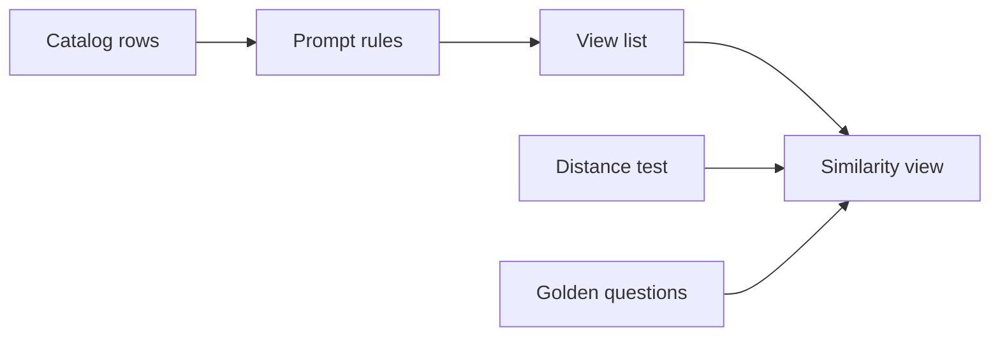
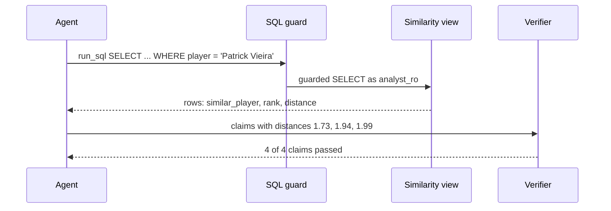

# 34 Player similarity scout (one season at a time)

| | |
|---|---|
| Work | Feature: a ranked "who is most like this player?" list within one season, from one SQL view |
| Change | `aacf1e9` on `main` (squash of `feature/player-similarity-scout-one-season-at-a-time`), 2026-11-10 |
| Evidence | `blueprint/history/features/34-player-similarity-scout-one-season-at-a-time.md` (spec with step evidence, independent review receipt), build-plan item 34, the commit message, and the build conversation |
| Reader | A learner who can write basic code and is new to this stack |

This document obeys the rules of ASD-STE100 Simplified Technical
English. It is not a certified STE document.

## 1. Summary

This item lets the analyst answer "which players were most like Patrick Vieira?" within one season. A new view, `v_player_similarity`, gives a distance for each pair of players. The agent reads the list from the view and cites each distance as a claim, so the verifier can check it. A question that crosses the two seasons gets `unavailable` with an alternative. The one idea to remember: the model never computes a score, because the database computes every score.

## 2. Why this work exists

Fans often ask which player is like another player. Before this work, the analyst had no way to answer. The model could guess from memory, but a guess breaks the main rule of Highbury: every number comes from a tool output. Source: build-plan item 34.

The plan also limits the cost. An embedding API costs money for each call, and its scores do not match any row in the database. Thus the plan asks for a plain SQL distance. Source: build-plan item 34.

## 3. Design

The design is one view that turns per-match counts into a distance, plus small changes that let the agent use it.

| Part | Location | Job |
|---|---|---|
| Similarity view | `db/migrations/0012_player_similarity.sql` | Computes the distance and the rank for each pair of qualified players in one season. |
| View list | `services/analyst/src/analyst/sql_guard.py` | Lets `run_sql` read the new view. |
| Prompt rules | `services/analyst/src/analyst/prompt.py` | Tell the model how to use the view and when to decline. |
| Catalog rows | `ingest/src/ingest/curated.py` | Tell the model what each season compares. |
| Distance test | `ingest/tests/test_similarity.py` | Compares the view with distances that the test computes itself. |
| Golden questions | `evals/golden.yaml` | Add q33 to q35 for later eval runs. |

A z-score tells how far a value is from the mean of a group, in units of the spread of that group. This work uses z-scores so that a metric with large numbers, such as passes, does not hide a metric with small numbers, such as goals.

A Euclidean distance is the length of a straight line between two points. Here each player is a point, and each metric is one axis. A distance of 0 means the same profile.

## 4. Workflow

Example input: "Which Arsenal 2003-04 players were most like Patrick Vieira?"

1. The agent calls `resolve_player` and gets the exact name "Patrick Vieira".
2. The agent calls `run_sql` with a `SELECT` on `v_player_similarity`, ordered by `rank`.
3. The guard accepts the view because `AGENT_VIEWS` names it. ([sql_guard.py:27](../services/analyst/src/analyst/sql_guard.py#L27))
4. The view makes one row for each player, match, and metric. ([0012:6](../db/migrations/0012_player_similarity.sql#L6))
5. For 2003-04, the view keeps Arsenal players only. ([0012:40](../db/migrations/0012_player_similarity.sql#L40))
6. The view adds up each metric and the minutes for each player and season. ([0012:67](../db/migrations/0012_player_similarity.sql#L67))
7. The view keeps players with 900 minutes or more. ([0012:97](../db/migrations/0012_player_similarity.sql#L97))
8. The view turns each per-90 rate into a z-score within the season. ([0012:91](../db/migrations/0012_player_similarity.sql#L91))
9. The view pairs Vieira with each other player and computes the distance. ([0012:113](../db/migrations/0012_player_similarity.sql#L113))
10. The view ranks the pairs by distance, then by name. ([0012:148](../db/migrations/0012_player_similarity.sql#L148))
11. The agent writes the answer: Edu Gaspar 1.73, Ray Parlour 1.94, Gilberto Silva 1.99.
12. The verifier finds each distance in the rows of that `run_sql` call.

## 5. Decisions and tradeoffs

### 5.1 A plain SQL distance, with no embedding

- **Choice:** Compute the distance in a view with standard SQL.
- **Alternatives:** An embedding API, or the `pgvector` extension.
- **Reason:** Recorded: an embedding API costs money for each call, and no row can back its scores. `pgvector` only if a measured query is too slow. Source: build-plan item 34.
- **Cost:** The view computes all pairs again at each query. A query with no player filter takes about 3.5 s (finding F-05).

### 5.2 Z-scores within one season and a Euclidean distance

- **Choice:** One z-score for each metric among the qualified players of the season, then the distance, rounded to 2 decimals.
- **Alternatives:** A 0 to 100 score, `100 / (1 + distance)`.
- **Reason:** Recorded: the user chose the plain distance on 2026-11-10. Source: archive, In scope.
- **Cost:** A distance has no fixed scale, so the prompt says that lower is more alike and that it is not a percentage.

### 5.3 At least 900 league minutes

- **Choice:** A player qualifies with 900 league minutes or more in the season.
- **Alternatives:** 450 minutes.
- **Reason:** Recorded: the user chose 900. It keeps 14 Arsenal players for 2003-04 and 339 league players for 2025-26. Source: archive, In scope.
- **Cost:** Squad players with few matches do not appear.

### 5.4 Eight metrics for 2003-04, six for 2025-26

- **Choice:** For 2003-04, the five event metrics of item 25 plus goals, shots, and xG. For 2025-26, goals, assists, tackles, recoveries, CBI, and saves from FPL.
- **Alternatives:** Item 25 metrics only, or FPL points as a seventh metric.
- **Reason:** Recorded: without goal metrics, Henry and Pires look alike on chances created. FPL points, bonus, BPS, and price are scores made from the counts. Source: the build conversation and the archive, In scope.
- **Cost:** The two seasons have no shared scale, so a cross-season score is not possible (5.7).

### 5.5 One row for each metric, not one column

- **Choice:** The view stores each count as a row with a `metric` name.
- **Alternatives:** One column for each metric, with a separate formula for each season.
- **Reason:** Inferred: from the code. One window function and one join compute the z-scores and the distance for both seasons, with 8 or 6 metrics.
- **Cost:** The view joins more rows, and the reader must follow the `metric` key.

### 5.6 The player name is a group key of the pairs

- **Choice:** The `pairs` step groups by the player name, so a filter on `player` reaches the join.
- **Alternatives:** Join the names after the distance.
- **Reason:** Recorded: the first draft took 1.7 s for one player in 2025-26, and this change made it 0.21 s. Source: archive, step 1 evidence.
- **Cost:** Other filters, such as `similar_player`, still compute all pairs (F-05).

### 5.7 A cross-season question is declined

- **Choice:** The prompt makes such a question `unavailable`, with an alternative.
- **Alternatives:** A score on the few shared metrics.
- **Reason:** Recorded: cross-era comparisons use only shared metrics, and the xG models differ. Source: the locked rules and build-plan item 34.
- **Cost:** A popular question ("who now is like Henry?") gets no list.

### 5.8 The minutes rule is in words in the answer

- **Choice:** The prompt says "per 90" with a space and "ten full league matches", not "900".
- **Alternatives:** The first text, "per-90 profiles" and "900 league minutes".
- **Reason:** Recorded: the first live answer had an unbacked "90", because the verifier skips only "per 90" with a space. Source: archive, step 5 evidence, and [verifier.py:23](../services/analyst/src/analyst/verifier.py#L23).
- **Cost:** The answer does not show the exact number of minutes.

## 6. Blast radius

### 6.1 This work needs

| Dependency | Used for | If it fails |
|---|---|---|
| `v_player_match_advanced` | The five 2003-04 event metrics | Postgres refuses to drop or change it while this view depends on it. |
| `player_match_stats`, `shots` | 2003-04 minutes, goals, shots, xG | Wrong or no 2003-04 rows. |
| `fpl_player_match` | All 2025-26 counts and minutes | No 2025-26 rows. |
| The 5 s statement timeout | Each query of the agent | A query with no player filter can stop with the timeout text (F-05). |
| `GRANT SELECT` to `analyst_ro` | Agent access | `run_sql` returns a permission error. |

### 6.2 These things use this work

| Consumer | Uses | Found in |
|---|---|---|
| SQL guard and `get_schema` | `AGENT_VIEWS` entry | [`sql_guard.py:27`](../services/analyst/src/analyst/sql_guard.py#L27) |
| Agent prompt | Similarity rules | [`prompt.py:65`](../services/analyst/src/analyst/prompt.py#L65) |
| Data catalog | Two `similarity` rows | [`curated.py:147`](../ingest/src/ingest/curated.py#L147), [`curated.py:242`](../ingest/src/ingest/curated.py#L242) |
| MCP guide | Views list | [`docs/mcp.md:176`](../docs/mcp.md#L176) |
| Golden questions | q33 to q35 | `evals/golden.yaml` |

### 6.3 If you change this work

| If you change | Then check |
|---|---|
| A metric or the minutes rule | The view comment, both catalog rows, the prompt rule, the test, and the golden SQL values. |
| A column of `v_player_match_advanced` | This view first: Postgres blocks the change. |
| The rank order or the 2 decimals | The golden values of q33 and q34. |
| The view name | `AGENT_VIEWS`, the prompt, the catalog, `docs/mcp.md`, and `test_schema.py`. |

### 6.4 How to remove this work

1. Add a migration that drops `v_player_similarity`.
2. Remove the view from `AGENT_VIEWS` and the two prompt rules.
3. Remove the two catalog rows, and run the curated loader.
4. Remove q33 to q35, the test, and the docs and changelog lines.

No table changes, so no data stays behind.

## 7. Code reading path

1. [`0012_player_similarity.sql:6`](../db/migrations/0012_player_similarity.sql#L6) - Look for: one row for each metric, from two sources.
2. [`0012_player_similarity.sql:67`](../db/migrations/0012_player_similarity.sql#L67) - Look for: the season minutes, and the club after a transfer.
3. [`0012_player_similarity.sql:81`](../db/migrations/0012_player_similarity.sql#L81) - Look for: z-scores, and the 0 for a metric with no spread.
4. [`0012_player_similarity.sql:101`](../db/migrations/0012_player_similarity.sql#L101) - Look for: the distance, and the name as a group key.
5. [`test_similarity.py:15`](../ingest/tests/test_similarity.py#L15) - Look for: the same formula in Python, as the test oracle.
6. [`prompt.py:65`](../services/analyst/src/analyst/prompt.py#L65) - Look for: the words that keep each number backed.
7. [`curated.py:147`](../ingest/src/ingest/curated.py#L147) - Look for: what the catalog tells the model.

## 8. Known limits

- F-04 (P2, open): for a 2003-04 opponent with no row, the prompt makes the model say "fewer minutes". The real reason is the Arsenal-only rule.
- F-05 (P2, unverified): a query with no player filter takes about 3.5 s locally. Nobody timed it on Neon.
- The feature is not live yet. Production needs the Neon migration and an API deploy, each with its own approval.
- The full evals did not run, so q33 to q35 show "not run" in `evals/results.md`.
- In 2003-04 the view joins the event metrics by player name within one match. Two players with one name in one match would break this.

## 9. Self-test

1. Why does the database compute the distance, and not the model?
2. What happens if one metric has the same per-90 rate for every qualified player?
3. Why does the 2025-26 profile have no xG?
4. What happens to the speed if you filter on `similar_player` and not on `player`?
5. Why does the answer say "ten full league matches" and not "900 minutes"?

Answers

1. The verifier can check a number only when a tool row holds it. A model-made score has no row. See sections 1 and 5.1.
2. The spread is 0, so the z-score of that metric is 0 and it adds nothing to the distance. See section 4, step 8.
3. Understat covers only Arsenal's matches, so the league-wide profile uses FPL counts. See section 5.4.
4. The filter does not reach the pair join, so the view computes all pairs, in about 3.5 s. See sections 5.6 and 8.
5. The verifier flags any number with no claim behind it, and no row holds 900. See section 5.8.

