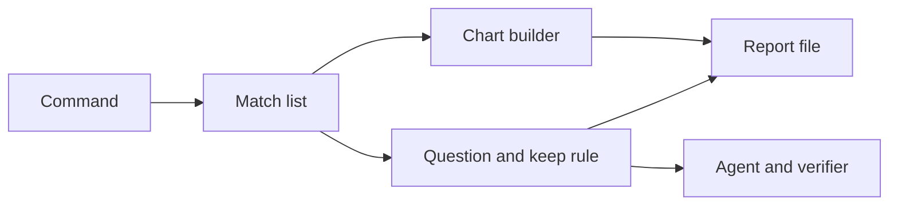
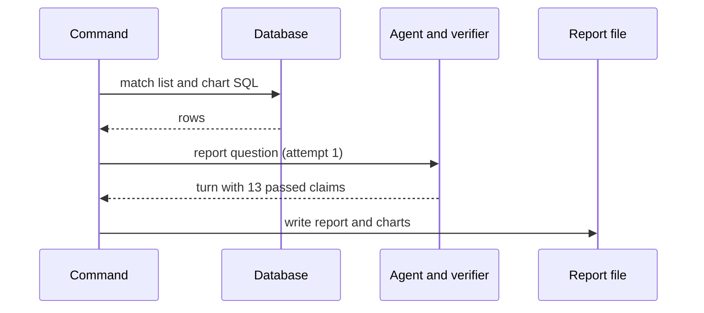

# 35a Match report generator

| | |
|---|---|
| Work | feature: an offline command that writes one verified report for each league match of Arsenal |
| Change | `60b671c` on `main`, 2026-11-12 |
| Evidence | `blueprint/history/features/35a-match-report-generator.md` (spec, findings 35a/F-04 and 35a/F-06), the commit message, and the build conversation |
| Reader | A learner who can write basic code and is new to this stack |

This document obeys the rules of ASD-STE100 Simplified Technical
English. It is not a certified STE document.

## 1. Summary

The command `python -m analyst.match_reports` asks the agent for a short report on each of the 76 league matches of Arsenal. It keeps a report only when the verifier passed every claim and the summary has no unbacked number. The command writes the reports to `apps/web/src/lib/match-reports.json`, and the repository keeps that file. Item 35b will show the file as static pages. The one idea to remember: the model runs once, offline, and a visitor reads only checked text.

## 2. Why this work exists

Before this work, each answer of Highbury came from a live question. Each live question costs money, and the site pays for it. The build plan asks for match reports that cost nothing when a visitor reads them. Thus the reports must exist before a visitor arrives. Recorded: the plan says "a visitor's view calls no model" (build plan, item 35).

A report must also obey the main rule of the project: no number without a source row. Without the keep rule, a report with a removed claim could go to the site. The plan forbids that: "no published report has a removed claim or an unbacked number".

## 3. Design

The design is one module with a pipeline of small functions, and a test seam at each place that costs money or reads a database.

| Part | Location | Job |
|---|---|---|
| Match list | `match_reports.py` (`load_matches`, `MatchInfo`) | Reads the 76 matches and gives each one a stable `slug` |
| Chart builder | `match_reports.py` (`match_charts`) | Builds the xG timeline and, for 2003-04, the pass network from fixed SQL |
| Question and keep rule | `match_reports.py` (`report_question`, `failure`, `ask_match`) | Asks the agent up to 3 times and keeps the first turn that passes |
| Report file | `match_reports.py` (`report_of`, `to_json`, `read_file`) | Writes the file after each match, in the same bytes for the same data |
| Command | `match_reports.py` (`main`, `parse`, `Deps`) | Picks the matches to ask, handles `--only`, `--limit`, `--pause`, and prints the cost |
| Tests | `test_match_reports.py` | Proves the rules with fixed rows and fake turns, and no model |

A **slug** is a short text key for a URL. This work uses `<date>-<opponent>`, for example `2004-04-09-liverpool`, because the database id changes when someone builds the database again.

## 4. Workflow

Example input: `python -m analyst.match_reports --only 2004-04-09-liverpool`, the trial run of 2026-11-12.

1. `main` reads the model name and the match list. (`match_reports.py:366`)
2. `load_matches` runs `MATCHES_SQL` through the SQL guard. (`match_reports.py:91`)
3. `read_file` reads the old file and stops on a different model. (`match_reports.py:265`)
4. `main` selects the one match that `--only` names. (`match_reports.py:380`)
5. `generate` builds every chart before the first paid question. (`match_reports.py:319`)
6. `ask_match` asks the agent on a new thread. (`match_reports.py:178`)
7. `agent.ask` runs the tools, then `verify` checks each claim. (`agent.py:282`, `verifier.py:74`)
8. `failure` returns `None`, because all 13 claims passed. (`match_reports.py:163`)
9. `report_of` adds the SQL of each cited query to its claim. (`match_reports.py:202`)
10. `generate` writes the file, then `main` prints the cost: $0.1477. (`match_reports.py:335`)

## 5. Decisions and tradeoffs

### 5.1 The command builds the charts, not the agent

- **Choice:** Fixed SQL and `charts.build` make each chart, as the landing tiles do.
- **Alternatives:** Let the agent call `build_chart` and keep its charts.
- **Reason:** Recorded: "so the agent spends its tool calls on the numbers that it must back". Source: the module docstring and the spec.
- **Cost:** The text and the chart can count different things. The pass network stops at the first substitution, but the trial summary counted the full match.

### 5.2 A report needs one claim or more

- **Choice:** A turn with no claim fails, as does a turn with a removed claim or an unbacked number.
- **Alternatives:** Accept a turn that states no number.
- **Reason:** Inferred from the keep rule: a report with no claim has nothing that the verifier checked. The spec lists it as a choice for review.
- **Cost:** A correct report with no number counts as a failed attempt and costs one more question.

### 5.3 Three attempts, then the match is left out

- **Choice:** `MAX_ATTEMPTS = 3`, and each attempt uses a new thread.
- **Alternatives:** Retry with no limit, or one attempt only.
- **Reason:** Recorded: the plan asks for "a fixed small number" of attempts. The comment at `match_reports.py:289` gives the reason for a new thread: "a retry must not read the failed answer".
- **Cost:** A match that fails three times costs three questions and has no page until a later run.

### 5.4 Batches, because the site shares the key

- **Choice:** `--limit N` asks at most N matches. A run asks new matches first and left-out matches last.
- **Alternatives:** One full run of 76 matches.
- **Reason:** Recorded: the full run (about $5.50) cost more than the credit on the key (about Rs 300). The site uses the same key. Source: the build conversation and spec step 4. Finding 35a/F-04 moved left-out matches to the end.
- **Cost:** The file stays partial across top-ups, and 35b must wait.

### 5.5 One file, one model

- **Choice:** `read_file` stops when the file came from a different model.
- **Alternatives:** Store the model on each report.
- **Reason:** Recorded: the code comment says "One file holds the reports of one model". Source: `match_reports.py:276`.
- **Cost:** A switch of model means a new file and a new paid run.

## 6. Blast radius

### 6.1 This work needs

| Dependency | Used for | If it fails |
|---|---|---|
| Local Postgres as `analyst_ro` | Match list and chart rows | The run stops before any paid question |
| The provider of `ANALYST_MODEL` | The report text | A failed call counts as an attempt. A 402 stops the whole run |
| `agent.ask` and `verify` | Answer and claim check | A change there changes which reports pass |
| `charts.build` | Chart data | A rejected chart stops the run and names the match |
| `evals/models.yaml` | Price for the cost line | The line says "cost unknown" |

### 6.2 These things use this work

No consumers yet. A search for `match-reports` and `match_reports` outside the module and its tests finds only `AGENTS.md:84`. Item 35b is the planned consumer.

### 6.3 If you change this work

| If you change | Then check |
|---|---|
| The keys of the report file | Item 35b, and `test_each_committed_report_passed_every_check` |
| The `slug` rule | The URLs of 35b, and resume, which finds reports by slug |
| `NOT_A_STATISTIC` in `verifier.py` | Which reports pass, here and for live questions |
| The question text | The pass rate and the cost of each batch |

### 6.4 How to remove this work

Delete `match_reports.py`, its test file, and `match-reports.json`. Then remove the line from `AGENTS.md`. No table, migration, or setting stays behind.

## 7. Code reading path

1. [`match_reports.py:58`](../services/analyst/src/analyst/match_reports.py#L58) - Look for: the slug, and why the file does not keep `match_id`.
2. [`match_reports.py:108`](../services/analyst/src/analyst/match_reports.py#L108) - Look for: the pass network rule before the first substitution.
3. [`match_reports.py:163`](../services/analyst/src/analyst/match_reports.py#L163) - Look for: the four ways a turn fails.
4. [`match_reports.py:178`](../services/analyst/src/analyst/match_reports.py#L178) - Look for: retries, and the stop on a 402.
5. [`verifier.py:74`](../services/analyst/src/analyst/verifier.py#L74) - Look for: how a claim passes or goes away.
6. [`match_reports.py:314`](../services/analyst/src/analyst/match_reports.py#L314) - Look for: charts first, then one write for each match.
7. [`match_reports.py:382`](../services/analyst/src/analyst/match_reports.py#L382) - Look for: the order of a batch.
8. [`test_match_reports.py`](../services/analyst/tests/test_match_reports.py) - Look for: `FakeAgent` and `FakeDatabase`, the two test seams.

## 8. Known limits

- The file holds 2 of 76 reports. The other 74 wait for a top-up of the key.
- Finding F-05 (unverified): the question gives the date. If the model writes the date in the summary, the verifier finds no claim for the 9 and the 2004. Then the attempt fails.
- The pass links in the text count the full match. But the pass network stops at the first substitution. Thus 35b must show that minute on the chart.
- The prose of a report can be stiff, for example "0 goals for Arsenal". The rule that each number needs a claim causes this.
- A test does not cover `production_ask`, the function that builds the real agent.

## 9. Self-test

1. Why does the file use a slug and not the `match_id` of the database?
2. What happens if the provider returns 402 in the middle of a batch?
3. Why does the command build every chart before the first question?
4. What happens if a report states a number that no claim backs?
5. Why does a batch ask new matches before left-out matches?

Answers

1. The id changes when someone builds the database again, but the date and the opponent stay. See section 3.
2. The run stops at once, and the file keeps the matches before it. See sections 5.4 and 6.1.
3. A chart that fails then costs nothing, because no question ran before it. See section 4, step 5.
4. `failure` rejects the turn, and the command asks again, up to 3 times. See sections 5.2 and 5.3.
5. A match that failed before can fail again and use the credit of each batch. See section 5.4.

