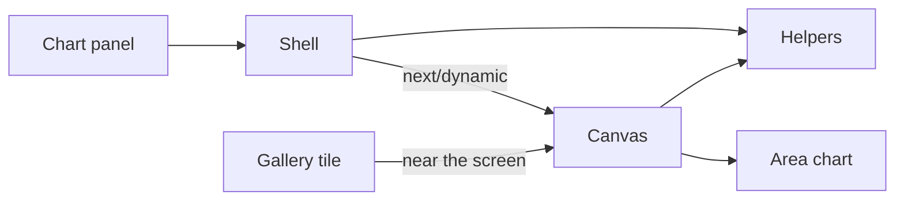
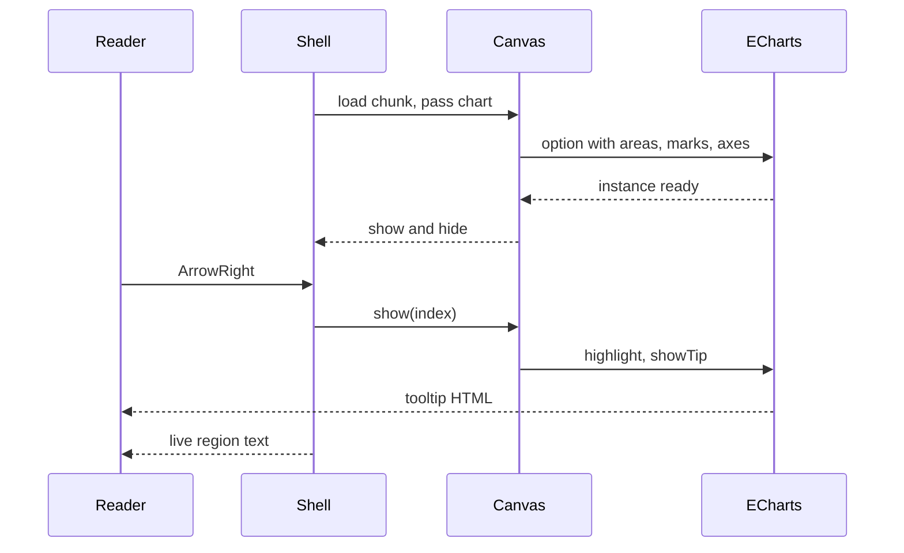

# 35b ECharts xG timeline

| | |
|---|---|
| Work | feature: the xG timeline drawn with ECharts, in answers and in the gallery tile |
| Change | `4197c43` on `main`, 2026-11-23 |
| Evidence | `blueprint/history/features/35b-echarts-xg-timeline.md` (spec, step 1 record, build notes, findings 35b/F-06 and 35b/F-07), the commit message, and the build conversation |
| Reader | A learner who can write basic code and is new to this stack |

This document obeys the rules of ASD-STE100 Simplified Technical
English. It is not a certified STE document.

## 1. Summary

The xG timeline shows the cumulative xG of two teams in one match, minute by
minute, with a mark at each shot. This work draws it with ECharts in place of
hand-made SVG. The new chart shows in two places: the chart of an answer and
the q16 tile of the home page gallery. It keeps the old tooltip text, the
summary text, and one keyboard stop for each shot. It shows no motion for a
reader who asks for reduced motion. The one idea to remember: the heavy chart
code is in a separate chunk, and a light shell keeps the text and keyboard rules.

## 2. Why this work exists

Before this work, the timeline was an SVG image that the site made with `d3-scale`.
The user chose evilcharts for every chart of the planned match report pages
(item 35c), and one look for this chart across the site. Source: the spec Goal,
decision of 2026-11-12. Without this work, two different timelines would show: one
in the answers and one on the report pages of 35c. Item 35c builds its pages on this
chart, so 35b comes first.

## 3. Design

The design is a light shell that loads a heavy canvas when the browser needs it.

ECharts is a chart library that draws on a `<canvas>` element. This work uses it
because the evilcharts components that the user chose use ECharts.
The evilcharts library is a set of chart components. The shadcn command-line
tool copies them into the repository as source. This work uses the evilcharts
area chart, so the timeline gets the stepped lines, the soft fill, and the
dashed grid of the approved prototype.

| Part | Location | Job |
|---|---|---|
| Shell | `apps/web/src/components/charts/xg-timeline.tsx` | Shows the title, the legend, the summary, and the keyboard group, and loads the canvas |
| Canvas | `apps/web/src/components/charts/xg-timeline-canvas.tsx` | Builds the ECharts option: the areas, the shot marks, the axes, and the tooltip |
| Area chart | `apps/web/src/components/evilcharts/charts/echarts-area-chart.tsx` | The copied evilcharts component that owns the ECharts instance |
| Helpers | `apps/web/src/lib/xg-timeline.ts` | Pure functions that turn the chart spec into rows, marks, tooltip HTML, and the axis top |
| Gallery tile | `apps/web/src/components/ask/gallery.tsx` | Shows a compact canvas when the tile comes near the screen |
| Chart panel | `apps/web/src/components/ask/chart-panel.tsx` | Picks the shell for an `xg_timeline` chart of an answer (not changed) |

`next/dynamic` is the Next.js way to load a component in its own chunk. This
work uses it with `ssr: false` because ECharts needs the browser `window`.

## 4. Workflow

Example input: the chart spec "Tottenham Hotspur v Arsenal, 2003-04" in an
answer. It has 9 Arsenal shots and 14 Tottenham shots. The last shot is a goal
in minute 93.

1. `ChartPanel` sees the type `xg_timeline` and shows `XgTimeline`. ([chart-panel.tsx:33](../apps/web/src/components/ask/chart-panel.tsx#L33))
2. `XgTimeline` calls `markOrder` and shows the title, the group, the legend, and the summary. ([xg-timeline.tsx:72](../apps/web/src/components/charts/xg-timeline.tsx#L72))
3. `next/dynamic` loads the canvas chunk in the browser. ([xg-timeline.tsx:13](../apps/web/src/components/charts/xg-timeline.tsx#L13))
4. `minuteRows` makes 94 rows, one for each minute from 0 to 93. ([xg-timeline-canvas.tsx:64](../apps/web/src/components/charts/xg-timeline-canvas.tsx#L64))
5. The canvas pairs each mark of `markOrder` with its point from `markPoints`. ([xg-timeline-canvas.tsx:68](../apps/web/src/components/charts/xg-timeline-canvas.tsx#L68))
6. The area chart builds two stepped areas, then calls `chartOptions`. ([echarts-area-chart.tsx:2166](../apps/web/src/components/evilcharts/charts/echarts-area-chart.tsx#L2166))
7. `chartOptions` adds 23 shot marks, the HT line, the axes, and the tooltip. ([xg-timeline-canvas.tsx:87](../apps/web/src/components/charts/xg-timeline-canvas.tsx#L87))
8. `onChartReady` gives the shell two actions: `show` and `hide`. ([xg-timeline-canvas.tsx:170](../apps/web/src/components/charts/xg-timeline-canvas.tsx#L170))
9. The reader presses ArrowRight. `onKeyDown` gets the next index from `nextIndex`. ([xg-timeline.tsx:100](../apps/web/src/components/charts/xg-timeline.tsx#L100))
10. `showMark` calls `show`, which sends `highlight` and `showTip` to ECharts. ([xg-timeline-canvas.tsx:186](../apps/web/src/components/charts/xg-timeline-canvas.tsx#L186))
11. The tooltip formatter calls `tooltipHtml` for that mark. ([xg-timeline-canvas.tsx:149](../apps/web/src/components/charts/xg-timeline-canvas.tsx#L149))
12. The live region reads the `shotLabel` text of the mark. ([xg-timeline.tsx:134](../apps/web/src/components/charts/xg-timeline.tsx#L134))

A live region is an element that a screen reader reads aloud when its text
changes. This work uses it because a canvas has no text for a screen reader.

## 5. Decisions and tradeoffs

### 5.1 The chart uses the evilcharts area chart on ECharts

- **Choice:** Copy the evilcharts area chart with the shadcn tool, and draw the timeline with it.
- **Alternatives:** Keep the SVG chart, or write ECharts options with no component.
- **Reason:** Recorded: the user chose evilcharts for every report chart, and one look for this chart across the site. Source: spec Goal.
- **Cost:** The lazy chunk is 744 kB, 250.1 kB with gzip. The copied file has 2,360 lines that the project now owns.

### 5.2 A light shell loads a heavy canvas

- **Choice:** The shell keeps the text and the keyboard rules. Only the canvas loads ECharts, through `next/dynamic`.
- **Alternatives:** The spec put the dynamic import in `chart-panel.tsx`, around the whole chart.
- **Reason:** Recorded: the title, the legend, and the summary stay in the server HTML. Source: build notes of the spec.
- **Cost:** Two files for one chart. The canvas is empty until its chunk arrives.

### 5.3 The copied component gets two small extensions

- **Choice:** `chartOptions` also takes a function, and a new `onChartReady` prop gives the ECharts instance.
- **Alternatives:** Find the instance through a DOM attribute of ECharts, or fork the whole component.
- **Reason:** Recorded: an object in `chartOptions` was a shallow merge, which replaced the `series` list. Source: step 1 record.
- **Cost:** A new run of the shadcn add command overwrites these changes.

### 5.4 One row for each minute, with steps at the shot

- **Choice:** `minuteRows` gives one row for each minute, and the canvas sets `step: "end"`.
- **Alternatives:** One point for each shot on a value axis.
- **Reason:** Recorded: the evilcharts x axis is a category axis. Its `step` curve maps to `"middle"`, which puts each jump half a minute early. Source: spec Data, step 1 record.
- **Cost:** The tick rule uses the row index as the minute, so the rows must start at minute 0.

### 5.5 The canvas does not render again on a key press

- **Choice:** `memo` wraps the canvas, and the shell passes a stable `onReady`.
- **Alternatives:** Keep the canvas plain, and show the tooltip again after each render.
- **Reason:** Recorded: each arrow key rendered the area chart again. Its `notMerge` push closed the tooltip that `showTip` opened. Source: build notes, browser check.
- **Cost:** A new prop of the canvas must also be stable, or the bug comes back.

### 5.6 The gallery tile loads the chart near the screen

- **Choice:** An `IntersectionObserver` with a margin of 400 px mounts the tile canvas.
- **Alternatives:** Mount the canvas with the page.
- **Reason:** Recorded: every visit to `/` fetched 250 kB for a tile 3,899 px down. Source: finding 35b/F-06.
- **Cost:** A reader who scrolls fast can see an empty tile for a moment.

### 5.7 The tooltip HTML is escaped in a tested helper

- **Choice:** `tooltipHtml` escapes each line, and a test checks `<` and `&` in a player name.
- **Alternatives:** Escape inside the component, with no test.
- **Reason:** Recorded: the ECharts tooltip renders HTML, and a player name is data. Source: spec step 2.
- **Cost:** None found.

### 5.8 One lint rule is off for the copied file

- **Choice:** A comment at the top turns off `react-hooks/refs` for the area chart file.
- **Alternatives:** Rewrite the live state of the component as React state.
- **Reason:** Recorded: the upstream code reads a ref object during render by design, which gave 8 errors. Source: step 1 record.
- **Cost:** The rule does not check new code in that file.

## 6. Blast radius

### 6.1 This work needs

| Dependency | Used for | If it fails |
|---|---|---|
| `echarts` 6.1.0 | Draws the chart | The chunk does not load. The title, legend, and summary show, but the box stays empty |
| `motion` 14.14.0 | `useReducedMotion` in the area chart | The chunk does not build |
| CSS tokens `--brand`, `--foreground`, `--surface-chart`, `--ring`, `--line-mid` | Team and mark colors | If a token is absent, its color is empty, and ECharts uses its default color |
| The `xg_timeline` chart spec of the API | The data | `ChartPanel` shows its fallback card for a chart that fails the schema |
| `IntersectionObserver` in the browser | The gallery tile | The tile stays empty, but its summary label stays |

### 6.2 These things use this work

| Consumer | Uses | Found in |
|---|---|---|
| Chart panel | `XgTimeline` | `apps/web/src/components/ask/chart-panel.tsx:34` |
| Gallery tile | The canvas, `compact` | `apps/web/src/components/ask/gallery.tsx:64` |
| Gallery tile | `summaryText` | `apps/web/src/components/ask/gallery.tsx:59` |
| Helper tests | All exported helpers | `apps/web/src/lib/xg-timeline.test.ts:16` |
| Area chart | `chartOptions`, `onChartReady` | `apps/web/src/components/charts/xg-timeline-canvas.tsx:12` |

Item 35c will use the canvas on the match pages. No code of 35c exists yet.

### 6.3 If you change this work

| If you change | Then check |
|---|---|
| The order of `markOrder` | The keyboard index and the data index of the marks must stay equal |
| A prop of the canvas | It must be stable, or each key press closes the tooltip (5.5) |
| The first row of `minuteRows` | The ticks at 0, 15, 30, HT, 60, 75, and 90 |
| The copied evilcharts files | A new shadcn add overwrites the two extensions (5.3) |
| The filter of the compact form | The tooltip reads the same `shown` list (35b/F-07) |

The work also touched shared ground: `package.json`, the lockfile, and the
`registries` key of `components.json`. The Content-Security-Policy did not
change, and `d3-scale` stays for four other charts.

### 6.4 How to remove this work

1. Revert commit `4197c43`.
2. Run `pnpm install` in `apps/web`.

The revert brings back the SVG chart and its helpers. It removes `echarts`,
`motion`, the evilcharts files, and the registry entry. No data or
configuration stays behind.

## 7. Code reading path

1. [`apps/web/src/lib/xg-timeline.ts:76`](../apps/web/src/lib/xg-timeline.ts#L76) - Look for: how `minuteRows` copies the spec totals and calculates no new number.
2. [`apps/web/src/lib/xg-timeline.ts:110`](../apps/web/src/lib/xg-timeline.ts#L110) - Look for: the escape of each tooltip line.
3. [`apps/web/src/lib/xg-timeline.ts:122`](../apps/web/src/lib/xg-timeline.ts#L122) - Look for: the axis top of at least 1.
4. [`apps/web/src/components/charts/xg-timeline.tsx:72`](../apps/web/src/components/charts/xg-timeline.tsx#L72) - Look for: the group, the key rules, and the live region.
5. [`apps/web/src/components/charts/xg-timeline-canvas.tsx:68`](../apps/web/src/components/charts/xg-timeline-canvas.tsx#L68) - Look for: the one `shown` list for the data and the tooltip.
6. [`apps/web/src/components/charts/xg-timeline-canvas.tsx:87`](../apps/web/src/components/charts/xg-timeline-canvas.tsx#L87) - Look for: the changes that the canvas makes to the built option.
7. [`apps/web/src/components/charts/xg-timeline-canvas.tsx:170`](../apps/web/src/components/charts/xg-timeline-canvas.tsx#L170) - Look for: `showTip` with the series index.
8. [`apps/web/src/components/evilcharts/charts/echarts-area-chart.tsx:2166`](../apps/web/src/components/evilcharts/charts/echarts-area-chart.tsx#L2166) - Look for: the function form of `chartOptions`.
9. [`apps/web/src/components/ask/gallery.tsx:248`](../apps/web/src/components/ask/gallery.tsx#L248) - Look for: the observer that mounts the tile canvas.

## 8. Known limits

- On a phone, the answer chart is short. It keeps the old 15:8 shape.
- The vendored files register `SVGRenderer`, which the timeline does not use. It adds bytes to the chunk.
- No dependency scan (`pnpm audit`) ran for `echarts` and `motion`, because it needs the network.
- The browser check used a recorded answer stream, not a live model answer.
- A console error comes from zod, not from this work: the CSP blocks its `Function("")` test, and zod continues.
- A shadcn add of a new evilcharts chart can overwrite the shared `ui` files. Read the diff after each add.

## 9. Self-test

1. Why does the shell, and not the chart panel, hold the dynamic import?
2. What happens if the canvas renders again after each arrow key?
3. Why does the canvas set `step: "end"` when the area chart has a `step` curve?
4. What happens if the compact tile filters its marks but the tooltip reads the full list?
5. Why does a visit to `/` no longer download ECharts at the top of the page?

Answers

1. The shell keeps the title, the legend, and the summary in the server HTML. Only the canvas needs the browser. See section 5.2.
2. The area chart pushes a new option with `notMerge`, and the open tooltip closes. See section 5.5.
3. The area chart maps `step` to `"middle"`, which puts each jump half a minute before the shot. See section 5.4.
4. The tooltip of a goal shows another shot, because the data index points into a different list. See section 6.3.
5. The tile mounts its canvas only when the observer sees it within 400 px of the screen. See section 5.6.

